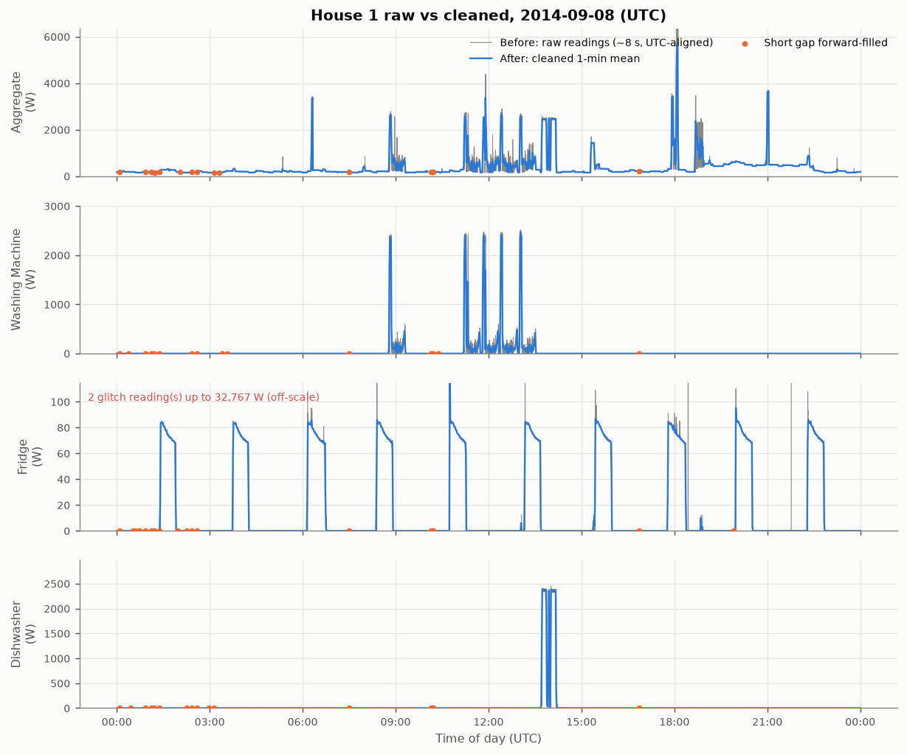

# DATA.md — Raw-data coverage, quality findings and cleaning decisions

All numbers below come from `python run_pipeline.py` and can be checked in
`outputs/tables/` (file named next to each section). Times are **UTC** unless stated.

## 1. Sources

| Item | Value |
|---|---|
| Dataset | REFIT Electrical Load Measurements (Murray, Stankovic & Stankovic, *Sci. Data* 4, 160122, 2017), CC-BY 4.0 |
| Raw files used (Task 1) | `REFIT_RAW_081116/RAW_House1_Part1.csv` (4,377,877 rows), `RAW_House1_Part2.csv` (4,140,886 rows) |
| Cleaned files used (Tasks 2–3) | `CLEAN_REFIT_081116/CLEAN_House{2,5,7,8,9,15,16,17,18}.csv` (+ all 19 washing-machine houses for a screening table) |
| Documentation | `references/CLEAN_READ_ME_081116.txt` (official readme, downloaded from the Strathclyde portal) |
| Units | Active power in **watts**, 1 aggregate current clamp + 9 plug-in Individual Appliance Monitors (IAMs) per house |
| Native sampling | Nominally 8 s; readings logged **only when the load changes**; sensors polled every 6–8 s and not synchronised |
| House 1 channels | Aggregate, Fridge, Freezer(1), Freezer(2), Washer Dryer, **Washing Machine (Appliance5)**, Dishwasher, Computer, Television Site, Electric Heater |

The original folders are never modified; every derived file goes to `outputs/`.

## 2. House 1 raw data: what was found

`outputs/tables/task1_timestamp_checks.csv`, `task1_cleaning_log.json`

| Check | Part1 | Part2 |
|---|---|---|
| Rows | 4,377,877 | 4,140,886 |
| Local time span | 2013-10-09 14:06 → 2014-10-01 01:27 | 2014-06-27 21:57 → 2015-07-10 11:56 |
| `Time` unparseable / `Unix` missing | 0 / 0 | 0 / 0 |
| `Time` vs `Unix` disagreement | 0 rows > 1 s (they differ by 0–1 s rounding only) | same |
| Sorted? | **No** — 1 backward jump | Yes |
| Repeated timestamps (Δt = 0) | **1,003,950** | 14,755 |
| Exact duplicate rows | **595,935** | 0 |
| Median / 99th pct interval between readings | 7 s / 16 s | 7 s / 9 s |
| Gaps > 10 min / > 1 h / > 1 day | 331 / 14 / 3 | 59 / 19 / 10 |
| Missing-value convention | unavailable sensors written as **0** | unavailable sensors written as **NaN** |

**Findings that drove decisions**

1. **Raw timestamps are UK wall-clock time, not UTC.** The only backward jump in Part1 is
   2013-10-27 01:59:59 → 01:00:01, exactly the BST→GMT clock change; local 01:00–02:00 on
   the spring-forward days (2014-03-30, 2015-03-29) never appears. In winter the official
   cleaned file has identical timestamps; in summer (where corrected) it is 1 h earlier.
2. **Part2's 2014-10-26 fall-back hour is unrecoverable**: both 01:00–02:00 hours were sorted
   together and interleave (e.g. 264 W / 170 W alternating every 4 s). The official
   cleaned file contains the same interleaved hour.
3. **Part1 and Part2 overlap for 95 days** (2014-06-27 → 2014-10-01) and **do not agree**:
   1-min aggregate r = 0.79 overall, with 39 of 91 days below r = 0.9 and no time shift
   explaining it. Physical consistency favours Part2: the plug monitors sum to more than the
   whole-house aggregate in 0.11 % of Part2 minutes vs 0.32 % of Part1 minutes.
4. **Impossible values are bit-pattern glitches.** IAM readings above 4 kW are dominated by
   8192, 4096, 16384, 32767, 65535, 98301 W (powers of two / 2¹⁵−1 / 2¹⁶−1) on 13 A plugs
   that cannot exceed ~3.1 kW. Aggregate readings > 20 kW occur in 2–13-sample bursts
   (e.g. 477 → 29,159 → 477 W within 14 s).
5. **High but genuine loads exist.** Aggregate reaches 10–12 kW on many days (an electric
   shower's signature: sustained for minutes, not single samples) and the washing machine
   draws 2.3–2.4 kW while heating. These are kept.

## 3. Cleaning pipeline (`src/wattwise/raw_cleaning.py`)

Each step logs the rows it touched (numbers from the last run):

| # | Step | Rule | Effect |
|---|---|---|---|
| 1 | Parse | `Unix` integer seconds is the clock of record (`Time` is the same clock, rounded) | 0 parse failures |
| 2 | Local → UTC | `Europe/London`; fall-back hour resolved by **file order** (rows before the backward jump = BST) where possible; interleaved copies dropped | Part1: 1,199 rows resolved; Part2: **986 rows dropped** (2014-10-26) |
| 3 | Merge parts | The later part wins from its first timestamp (NaN-aware, fewer physical violations — finding 3) | 1,257,865 Part1 rows dropped |
| 4a | Sort + exact duplicates | Stable sort by UTC time; identical rows dropped | 508,772 rows dropped |
| 4b | Conflicting duplicates | Rows sharing a timestamp collapsed to the **last non-null value per channel** (the logger appends the newest reading last) | 174,876 rows → 87,000 timestamps; 6,663,264 unique readings remain |
| 5 | Validity | Set to NaN (never to 0): any negative; aggregate = 0 W or > 20 kW; IAM > 4 kW | Aggregate: 97 > 20 kW, 8 zero; IAMs: 33–1,011 per channel (see `task1_validity_by_channel.csv`) |
| 6 | Resample | Mean of valid readings per minute (left-closed, labelled by minute start) | 920,031 minutes, 2013-10-09 13:06 → 2015-07-10 10:56 |
| 7 | Short gaps | Forward-fill NaN runs of **≤ 5 min** that have a preceding value; never partially fill longer runs | Aggregate: 893 minutes filled; flags `<channel>_filled` |
| 8 | Outages | Remaining aggregate NaN runs are listed and flagged (`outage` column), **not** filled | 381 outages, 118,793 min (82.5 days); longest 41.6 days |

Why these choices:

* **NaN instead of 0** for glitches (the official cleaning uses 0): a 0 in the middle of a
  2.3 kW heating phase would invent an "off" event; NaN plus short-gap filling restores the
  surrounding state instead.
* **Forward fill for short gaps** matches how the data were generated (a sensor reports
  only when its value changes, so "no reading" most often means "unchanged"). Five minutes
  is short relative to the appliance cycles of interest (30–180 min) and long relative to
  the 7 s logging interval. The longest outages (41.6, 8.6 and 7.5 days) are clearly
  hardware/network failures; filling them would fabricate consumption.
* **The resample mean** keeps energy: 1-min mean W × 1/60 h = Wh for that minute.

Output: `outputs/data/house1_raw_cleaned_1min.parquet` (10 channels + `_filled` flags +
`outage` + `n_readings`) and `outputs/tables/task1_outages.csv` (start, end, minutes).

## 4. Before/after evidence

| Figure | What it shows |
|---|---|
| `outputs/figures/task1_before_after_day.png` | One full day (2014-09-08, picked automatically as the day with the most corrections that also has washing activity) for Aggregate, Washing Machine, Fridge and Dishwasher: raw ~8 s readings vs the 1-min cleaned series, nulled glitches and forward-filled minutes marked. The fridge's 32,767 W glitch disappears; the washing machine's 2.4 kW heating blocks and the dishwasher's 2.3 kW phases are untouched. |
| `outputs/figures/task1_daily_max_before_after.png` | Daily maximum per channel over the whole study: the red "before" spikes into 10⁴–10⁵ W are removed, genuine kW-level peaks remain. |
| `outputs/figures/task1_coverage.png` | Readings per day and % of minutes with a valid aggregate; the February 2014 outage and the April–June 2015 outages stand out. |

## 5. Independent check against the official cleaned House 1

`outputs/tables/task1_vs_official_clean_monthly.csv` compares our 1-min aggregate with the
official cleaned file resampled the same way, at lags of −60, 0 and +60 min.

* **GMT months agree almost perfectly** at lag 0 (aggregate r = 0.990–0.999, MAE 2–11 W;
  washing machine r ≥ 0.996), which validates de-duplication and resampling.
* **2014-04 to 2014-06 (BST) also agree at lag 0** → our UTC conversion is the same as the
  official one where the official one was applied.
* **2014-10 and 2015-04 → 2015-07 agree only at lag −60 (r = 0.86–1.00)**: the official file
  is still on BST wall-clock time there. Day-level analysis shows the official correction
  stops exactly where raw Part1 ends (2014-10-01).
* **2014-07 to 2014-09 agree only partially (r = 0.71–0.91)**: the official file used Part1
  where we use Part2, and the two parts genuinely disagree (finding 3).

### Consequence for Tasks 2–3: time-base repair of the official cleaned files

The same defect is present in **every** house used in Tasks 2–3 (`outputs/tables/timebase_audit.csv`).
`src/wattwise/timebase.py` audits each BST day by correlating the official aggregate with the
raw aggregate under both hypotheses (official = UTC or official = local) and shifts local
days back by one hour:

| House | BST days | already UTC | still local → corrected | undecided (inherit neighbour) |
|---|---|---|---|---|
| 2 | 299 | 218 | 79 | 4 |
| 5 | 323 | 207 | 111 | 7 |
| 7 | 292 | 181 | 110 | 2 |
| 8 | 250 | 178 | 69 | 5 |
| 9 | 279 | 163 | 112 | 5 |
| 15 | 291 | 174 | 113 | 6 |
| 16 | 272 | 106 | 164 | 4 |
| 17 | 275 | 179 | 93 | 4 |
| 18 | 256 | 181 | 74 | 4 |

The decisions are unambiguous (median winning r = 0.999) and form contiguous periods
(e.g. House 2: UTC until 2014-08-31, local 2014-09-01..04, UTC for the rest of September,
local from 2014-10-01). Without this repair, hour-of-day results would be off by one hour
for 25–60 % of summer days.

## 6. Cleaned-data quality issues handled in Tasks 2–3 (`src/wattwise/clean_data.py`)

* **Missing minutes**: the official files forward-filled sensor NaNs at row level but outages
  remain as gaps between rows. Any minute with no row is missing (`n_rows = 0`).
* **Frozen values**: forward-filling turns a dead plug monitor into a constant. Non-zero
  WM power that is *exactly* constant for ≥ 60 min is flagged `wm_stuck` and excluded
  (real washing fluctuates minute to minute). This removed 23,578 minutes in House 5 —
  about half of that house's ">20 W" minutes — and 595 in House 15.
* **`Issues` flag** (IAM sum > aggregate): minutes with `Issues = 1` are kept for EDA
  coverage figures but excluded from model training and evaluation, as the readme advises.

## 7. Remaining concerns

1. **Which raw part is right in Jul–Sep 2014 is not provable.** Our choice (Part2) is the
   more physically consistent one, but 39 days disagree materially with Part1.
2. **Single-sample spikes below 4 kW are kept.** Single readings > 300 W and > 5× both
   neighbours are counted, not removed (`isolated_spikes_kept` in `task1_cleaning_log.json`):
   2,910 in the aggregate, 1,589 on Freezer(1), 368 on the Fridge, 186 on the Washing Machine,
   out of 6.66 million readings. They mix
   bit glitches (512/1,024/2,048 W) with real start-up transients (e.g. ~900 W
   freezer-compressor inrush at a consistent value). One 8-s reading moves a 1-min mean by
   at most ~1/8 of its value, so we report rather than remove them.
3. **Part1 zeros are ambiguous** for appliance channels (off vs. sensor unavailable); only
   the aggregate's impossible 0 W is treated as missing.
4. **Sensors are not synchronised** (6–8 s polling), so per-minute IAM sums can briefly
   exceed the aggregate; 47,648 readings (0.7 %) show this.
5. **Appliance identity can drift**: the readme warns that occupants may have moved plugs;
   House 4's first washing-machine channel is almost never active (0.3 % of minutes ≥ 20 W,
   0.75 cycles/week) and was excluded for that reason.
6. **The 2014-10-26 ambiguous hour** is dropped in our House 1 series but present
   (interleaved) in the official cleaned files used for Tasks 2–3; it affects one hour per
   house.
