# RESULTS.md — Washing-machine EDA and disaggregation model

Everything here is produced by `python run_pipeline.py` (tables in `outputs/tables/`,
figures in `outputs/figures/`). Times in plots and hour/weekday statistics are UK local time
(Europe/London) after the time-base repair described in [DATA.md §5](DATA.md#5-independent-check-against-the-official-cleaned-house-1).

## 1. Households and periods

Data: official cleaned REFIT files, resampled to 1-minute means (`src/wattwise/clean_data.py`).

All 19 houses whose readme lists a dedicated washing machine were screened
(`task2_wm_channel_screen.csv`). Nine were selected for the EDA and the model:

| House | WM column | Period (UTC) | Coverage | Observed days | Notes |
|---|---|---|---|---|---|
| 2 | Appliance2 | 2013-09-17 → 2015-05-28 | 75.4 % | 465 | lowest coverage |
| 5 | Appliance3 | 2013-09-26 → 2015-07-06 | 90.6 % | 588 | 23,578 frozen WM minutes removed; 8.4 % `Issues` minutes |
| 7 | Appliance5 | 2013-11-01 → 2015-07-08 | 87.4 % | 536 | heaviest user |
| 8 | Appliance4 | 2013-11-01 → 2015-05-10 | 89.7 % | 498 | **also owns a washer-dryer** (separate channel) |
| 9 | Appliance3 | 2013-12-17 → 2015-07-08 | 84.6 % | 481 | also owns a washer-dryer |
| 15 | Appliance3 | 2013-12-17 → 2015-07-08 | 86.3 % | 490 | |
| 16 | Appliance5 | 2014-01-10 → 2015-07-08 | 82.7 % | 449 | |
| 17 | Appliance4 | 2014-03-06 → 2015-06-19 | 93.8 % | 441 | |
| 18 | Appliance5 | 2014-03-07 → 2015-05-24 | 94.1 % | 417 | lightest user; also owns a washer-dryer |

Why these nine: each has a channel labelled "Washing Machine" (washer-dryers excluded
because their drying phase is a different load), clean heating (≈2 kW) and tumbling
(50–150 W) signatures, and ≥ 14 months of data. They are also the washing-machine houses
used in the seq2point REFIT literature (Zhang et al., 2018; train 2/5/7/9/15/16/17,
validation 18, test 8 in a public implementation), which makes the setting recognisable.
House 4 was rejected because its first washing-machine channel is active in only 0.3 % of
minutes (0.75 cycles/week), suggesting the plug was moved or the machine replaced. Other
houses (e.g. 3, 10, 13) look usable and are listed in the screen as candidates for extension.

## 2. Availability and data quality (`task2_availability.csv`)

| House | Missing gaps ≥ 10 min | Gaps ≥ 1 day | Longest gap (days) | WM exactly 0 W | WM 0–5 W (standby) | WM ≥ 20 W | Cycles | Rejected events | Cycles / week |
|---|---|---|---|---|---|---|---|---|---|
| 2 | 412 | 11 | 62.0 | 94.4 % | 0.3 % | 4.69 % | 325 | 48 | 4.9 |
| 5 | 673 | 9 | 8.6 | 53.6 % | 40.3 % | 5.61 % | 655 | 541 | 7.8 |
| 7 | 93 | 11 | 41.6 | 74.9 % | 16.6 % | 8.38 % | 855 | 74 | 11.2 |
| 8 | 61 | 8 | 39.1 | 84.0 % | 12.5 % | 3.32 % | 363 | 78 | 5.1 |
| 9 | 59 | 9 | 41.6 | 90.6 % | 6.6 % | 2.68 % | 247 | 23 | 3.6 |
| 15 | 582 | 11 | 8.6 | 96.2 % | 0.5 % | 2.90 % | 251 | 144 | 3.6 |
| 16 | 583 | 14 | 18.1 | 93.3 % | 2.8 % | 3.70 % | 313 | 51 | 4.9 |
| 17 | 93 | 6 | 8.6 | 96.6 % | 0.6 % | 2.40 % | 278 | 215 | 4.4 |
| 18 | 49 | 7 | 8.6 | 98.5 % | 0.2 % | 1.20 % | 132 | 41 | 2.2 |

The washing machine is **off (0–5 W) for 91–98 % of observed minutes in every house**.
This class imbalance is the single most important fact for modelling and evaluation.
Standby differs by house: some machines report exactly 0 W when idle, others 1–5 W
(House 5: 40 % of minutes), which is why the "on" threshold sits well above 5 W.

## 3. Cycle-detection rule (`src/wattwise/cycles.py`, parameters in `config.yaml`)

In plain language: **a wash is running whenever the machine draws at least 20 W; pauses of up
to 10 minutes (soaking, drum rest) do not end it; and to count as a wash it must last at least
15 minutes, use at least 50 Wh, reach at least 300 W at some point (water heating or spinning)
and not exceed 6 hours.** Statistics per cycle: start, end, duration, active minutes, missing
minutes, peak power, mean active power, energy (Wh = Σ 1-min mean W / 60), heating energy
(minutes ≥ 1 kW).

How the numbers were chosen from the data rather than assumed:

* **20 W**: standby is 0–5 W in all nine houses; tumbling is 50–150 W. Kelly & Knottenbelt
  (2015) use the same idea (power threshold + minimum on/off durations) for appliance
  activations; we re-derived the values for REFIT.
* **10-minute merge**: the gaps between consecutive ≥ 20 W minutes fall steeply from
  3,933 one-minute gaps to ~50 per minute-bin at 8–12 minutes and then flatten
  (hours-long gaps between washes); 10 minutes sits at that knee.
* **Robustness**: across thresholds {10, 20, 50 W} × merge gaps {5, 10, 20 min}, the
  total number of cycles varies only from 3,277 to 3,532 (±4 %; `task2_detection_sensitivity.csv`).
* **Rejected events** are mostly `too_short` (isolated spikes and short bursts of
  activity, most numerous in House 5 and House 17); 8 `too_long` events in House 5 are residual
  frozen-sensor periods.

Result: **3,419 accepted cycles** in nine houses (`task2_cycles.csv`).

## 4. Usage patterns (`task2_hour_of_day_pct.csv`, `task2_weekday_pct.csv`)

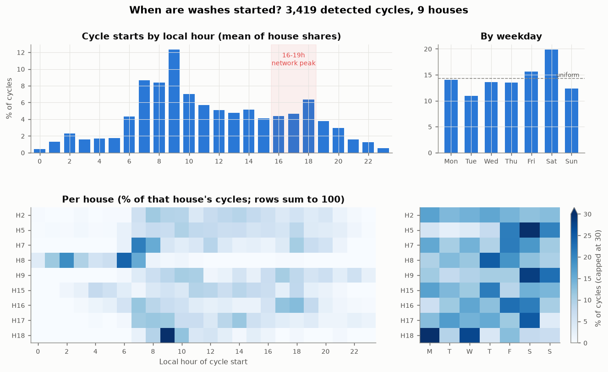

* **Washing is a morning activity.** Averaged over houses, 36 % of cycles start between
  07:00 and 10:59 and 52 % between 06:00 and 12:59; only 9 % start between midnight and
  05:59.
* **15 % of cycles start in the 16:00–18:59 evening peak** of the GB network (overall 16 %
  of all cycles), ranging from 0.6 % (House 8) to 31 % (House 16).
* **Saturday is the busiest day** (19.9 % of cycles vs 14.3 % if uniform); Tuesday the
  quietest (11.0 %).
* **Households differ more than the pooled averages suggest.** House 8 starts 76 % of its washes
  between 01:00 and 06:59 — consistent with a delay timer on a night tariff (e.g. Economy 7),
  i.e. it has already shifted its load. House 18 starts 57 % of washes in the 09:00 hour (a fixed
  routine). House 5 does 39 % of its washing on Saturdays and 60 % at weekends.

## 5. Cycle characteristics across houses (`task2_cycle_characteristics.csv`)

| House | Cycles | Median duration (min) | Median energy (Wh) | Median peak (W) | Median heating share | Weekend share |
|---|---|---|---|---|---|---|
| 2 | 325 | 97 | 617 | 2,091 | 0.80 | 25 % |
| 5 | 655 | 45 | 308 | 2,079 | 0.76 | 60 % |
| 7 | 855 | 60 | 543 | 2,083 | 0.78 | 29 % |
| 8 | 363 | 61 | 812 | 2,338 | 0.88 | 22 % |
| 9 | 247 | 73 | 645 | 2,210 | 0.80 | 51 % |
| 15 | 251 | 91 | 694 | 2,180 | 0.79 | 29 % |
| 16 | 313 | 73 | 626 | 2,050 | 0.85 | 31 % |
| 17 | 278 | 61 | 385 | 2,046 | 0.77 | 29 % |
| 18 | 132 | 49 | 318 | 2,191 | 0.74 | 14 % |

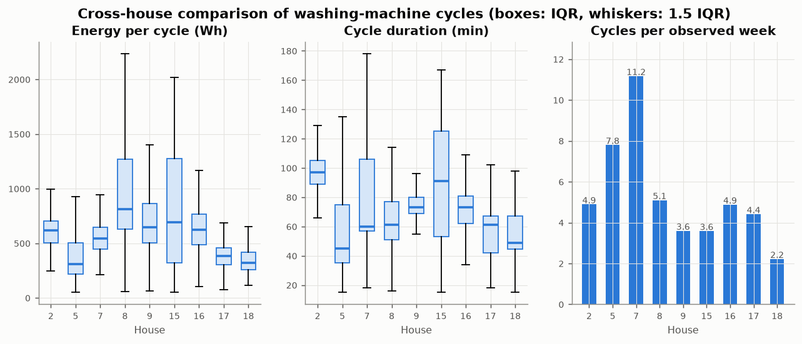

*Interpretation.* Peak power is almost identical everywhere (≈2.0–2.3 kW, the heating
element), but **energy per cycle varies 2.6-fold** between house medians (308 Wh in House 5
to 812 Wh in House 8), and House 8 and House 15 have very wide spreads (IQR ≈ 640–960 Wh),
i.e. they use very different programmes. Since **heating accounts for 74–88 % of a typical
cycle's energy** (70–90 % of each house's total washing energy), the wash temperature chosen
is the dominant driver of washing-machine consumption, more than frequency alone. Annual
washing-machine energy (extrapolated from observed days) ranges from ~42 kWh (House 18) to
~332 kWh (House 7), 1–7 % of each household's metered electricity.

### Mandatory plots

**(i) Representative 24-hour trace** — House 2, Wed 10 Sep 2014 (picked automatically: full
coverage, one cycle, energy closest to the house median).

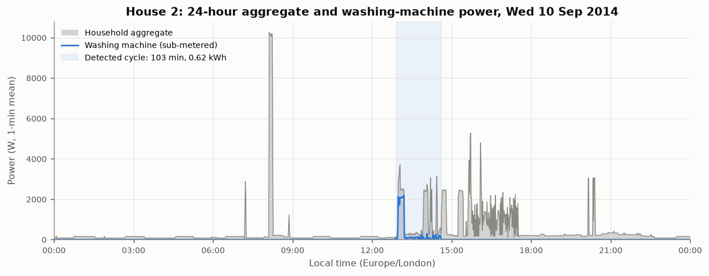

The washing machine's ~2.1 kW heating block at 13:00 is clearly visible in the aggregate,
but the following 90 minutes of tumbling (50–300 W) are buried under other loads, and the
afternoon contains several other 2–5 kW events (cooking, kettle) with similar step sizes. This is
the core NILM difficulty: the heating phase is detectable, the rest of the cycle is not.

**(ii) Detected cycles** — a median-energy cycle from four houses:

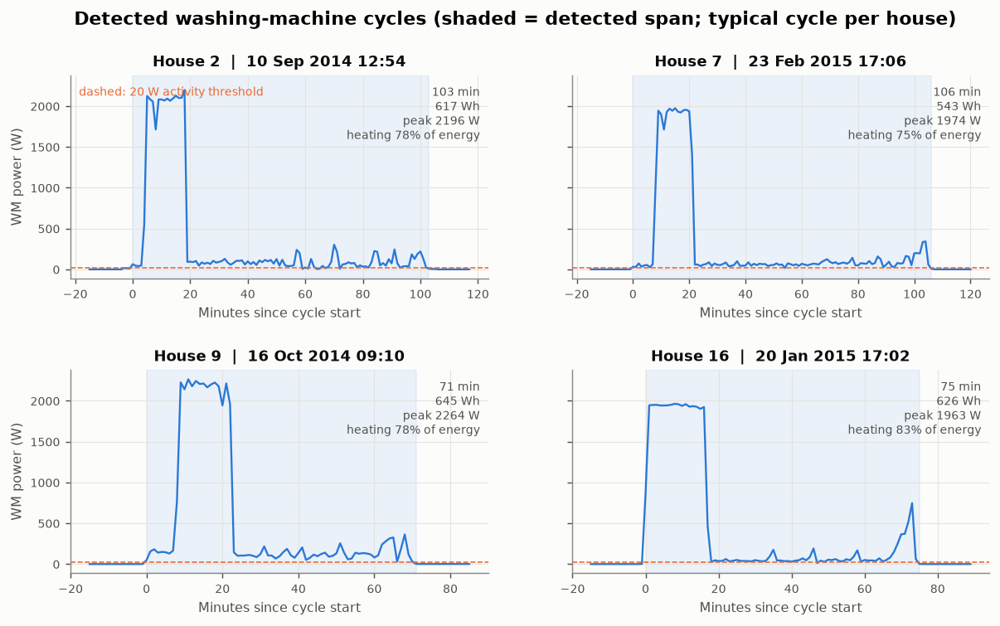

All four follow the same template: 10–20 min heating at ~2 kW at the start, 40–80 min of
low-power tumbling, then a short higher-power spin (300–750 W) at the end. The shaded span
shows that the rule captures the whole cycle, including the low-power phases and pauses.

**(iii) Cross-house comparison** — the box plots above (energy, duration, cycles/week).

## 6. Disaggregation model

### 6.1 Problem set-up

* **Input**: household aggregate power at 1-minute resolution (official cleaned data).
* **Target**: washing-machine power in W at the same minute (not just on/off).
* **Rows used**: minutes with data, a non-frozen WM value and no `Issues` flag.
* **Features (66, `src/wattwise/features.py`)** — computed from the aggregate only:
  rolling mean/std/min/max over 5–121 min, sum of absolute changes, share of minutes
  ≥ 1.5 kW above the 4-hour base load ("heater-like"), share of minutes 30–600 W above base
  ("tumble-like"), count of ±1.5 kW steps, lagged and leading differences (±1…60 min),
  missing-data share, and local hour (sin/cos) + weekend flag. Windows are **centred**: the
  intended use is retrospective disaggregation of stored meter data, where the minutes after
  t are available (the same assumption as seq2point's centred windows, Zhang et al., 2018).
  A **causal (past-only) ablation** quantifies what this costs.

### 6.2 Validation design (household hold-out)

| Split | Houses | Used for |
|---|---|---|
| Train | 2, 5, 7, 9, 15, 16 | fitting |
| Validation | 17 | early stopping, hurdle threshold, choosing between models |
| Test | 8, 18 | final, one-time evaluation |

* Splitting **by household** answers the utility's question — *how well does this work for a
  customer whose appliances were never sub-metered?* — and makes leakage between
  overlapping windows impossible: no house contributes minutes to two splits.
* Feature windows only ever use the house's own aggregate; the WM signal is never an input.
  The usage-profile baseline is fitted on training houses only; the threshold is tuned on
  validation only; the test houses were not used for any choice.
* **Training rows are sub-sampled** (all minutes within ±60 min of WM activity plus a random
  25 % of the rest, weighted ×4) to fit in 8 GB RAM without biasing the training
  distribution. Validation and test use every eligible minute.
* Test houses differ in behaviour (House 8: frequent, night-time, high-energy washes and a
  washer-dryer; House 18: light daytime user), which makes the test a deliberately hard
  transfer problem. Two houses is still a small sample (see limitations).
* A secondary **"seen-house" test** trains on the first 70 % of each training house's period
  and tests on its last 30 % to measure how much knowing the household helps.

### 6.3 Models

| Model | Description |
|---|---|
| Always-off | predicts 0 W (the trivial benchmark the brief warns about) |
| Constant mean | predicts the training mean every minute |
| Usage profile | mean WM power by local weekday × hour across training houses |
| LightGBM regression | one gradient-boosted regressor, squared error |
| **LightGBM hurdle** | P(on) classifier × E[power \| on] regressor; output = E[power \| on] if P ≥ τ else 0. τ = 0.30, tuned on validation for on/off F1. The idea of thresholding a classifier for on/off and regressing power follows Precioso & Gómez-Ullate (2020). |

**Selection rule (fixed before looking at test)**: lowest validation **daily energy MAE** among
the learned models — the metric closest to the product use case (a daily/monthly appliance
breakdown). The hurdle model was selected (0.070 vs 0.114 kWh/day for plain regression).

### 6.4 Metrics and why

| Metric | Why it is useful | Limitation |
|---|---|---|
| MAE / RMSE (W), all minutes | standard, in physical units | dominated by the 91–98 % off minutes: **always-off scores well** |
| MAE when on (W) | error when it matters | ignores false alarms |
| Energy error (%) | what an itemised bill would get wrong | over- and under-estimates cancel over time |
| Daily energy MAE (kWh/day) | per-day breakdown accuracy; penalises both missed and phantom washes | days with ≥ 90 % data only |
| Precision / recall / F1 (on ≥ 20 W) | detection quality per minute; always-off has F1 = 0 | the 50–150 W tumble phases are inherently hard |
| Cycle recall / precision | did we find the wash at all (any overlap)? closest to "count my washes" | lenient: any overlap counts |

### 6.5 Results on unseen test houses 8 + 18 (`task3_metrics.csv`)

| Model | MAE (W) | RMSE (W) | MAE on (W) | Energy error | Precision | Recall | F1 | Daily energy MAE (kWh) | Cycle recall | Cycle precision |
|---|---|---|---|---|---|---|---|---|---|---|
| Always-off | **15.2** | 172.7 | 752 | −100 % | 0 | 0 | 0 | 0.336 | 0 | – |
| Constant mean | 31.6 | 172.1 | 734 | +14 % | 0 | 0 | 0 | 0.427 | 0 | – |
| Usage profile | 31.9 | 173.1 | 736 | +16 % | 0.02 | 0.37 | 0.04 | 0.438 | 0 | – |
| LightGBM regression | 26.8 | **149.9** | 550 | +36 % | 0.16 | **0.89** | 0.27 | 0.315 | **0.88** | 0.27 |
| **LightGBM hurdle (selected)** | 16.5 | 161.0 | **534** | −21 % | **0.56** | 0.58 | **0.57** | **0.248** | 0.75 | **0.58** |
| Hurdle, causal features only | 18.7 | 175.7 | 592 | −20 % | 0.47 | 0.49 | 0.48 | 0.265 | 0.66 | 0.52 |

Pooled per-minute metrics use all test minutes together; pooled daily-energy MAE and cycle
recall/precision are the mean of the two houses' values.

Per test house (selected model vs always-off):

| House | F1 | Energy error | Daily energy MAE (model / always-off) | Cycles found | Cycle precision |
|---|---|---|---|---|---|
| 8 | 0.59 | −35 % | **0.382** / 0.571 kWh | 75 % of 360 | 67 % |
| 18 | 0.52 | **+92 %** | 0.114 / **0.101** kWh | 76 % of 129 | 49 % |

Seen-house temporal hold-out (training houses, later 30 % of each period; only the ~2-hour
feature window at each split point touches both periods, and it contains aggregate input only): F1 0.62,
MAE-on 228 W, energy error −8 %, daily energy MAE 0.208 kWh vs 0.448 for always-off,
cycle recall 0.80 / precision 0.69.

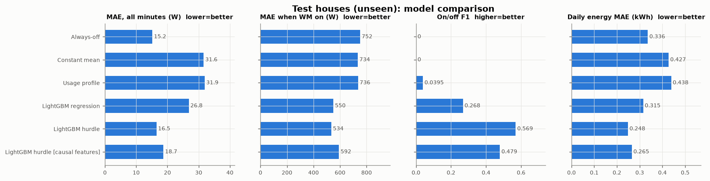

**Interpretation**

* **Always-off has the best plain MAE** (15.2 W) while detecting nothing — a clear
  demonstration that per-minute MAE alone is the wrong yardstick for a sparse appliance.
* **The hurdle model is the only one that is good at both "when" and "how much"**: F1
  0.57 (vs 0.04 for the usage profile), and the lowest daily-energy error (26 % below
  always-off, 43 % below the usage profile). It finds 75 % of washes; 58 % of its detections
  overlap a real wash.
* **Plain regression finds more washes (88 %) but predicts about three cycles per real one**
  (precision 0.27),
  because squared-error regression spreads small positive power across uncertain minutes.
* **Accuracy is household-dependent.** On House 8 the model clearly beats always-off; on
  House 18 (a light user) phantom detections make the energy estimate nearly double the
  truth and the daily error slightly worse than always-off. A pooled number hides this.
* **Look-ahead matters**: restricting to past-only features costs 0.09 F1 and about 10
  points of cycle recall. Real-time (live) detection would be weaker than the offline result.
* **Knowing the household helps a lot**: with earlier data from the same houses, MAE-on
  halves (534 → 228 W) and energy error shrinks to −8 %. A short calibration period per
  customer (or per-customer fine-tuning) is the most promising improvement.

### 6.6 Actual vs predicted (unseen House 8)

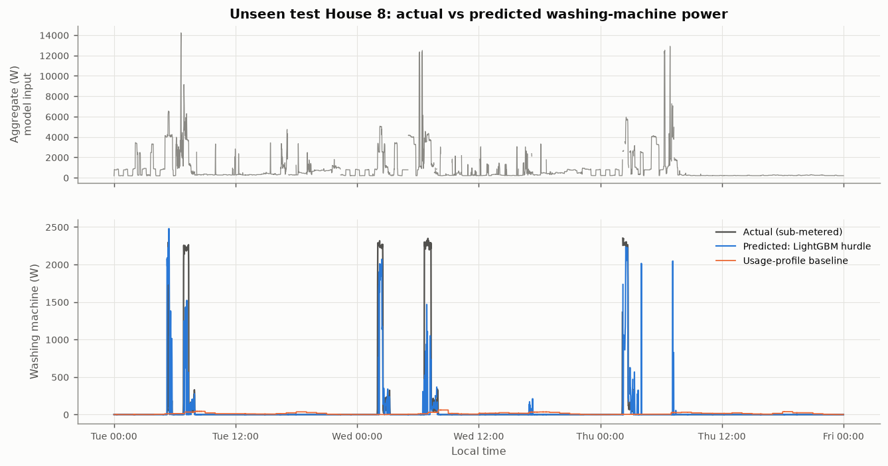

Three days with five real washes: every heating phase is at least partly detected at the
right time, but the predicted heating power and duration are often too low/short, the
low-power tumble phase is mostly predicted as off, and there are two short false
detections on Thursday (≈04:00 and ≈07:00). The usage-profile baseline (orange) is a flat ~20–60 W smear that never reflects an
actual wash.

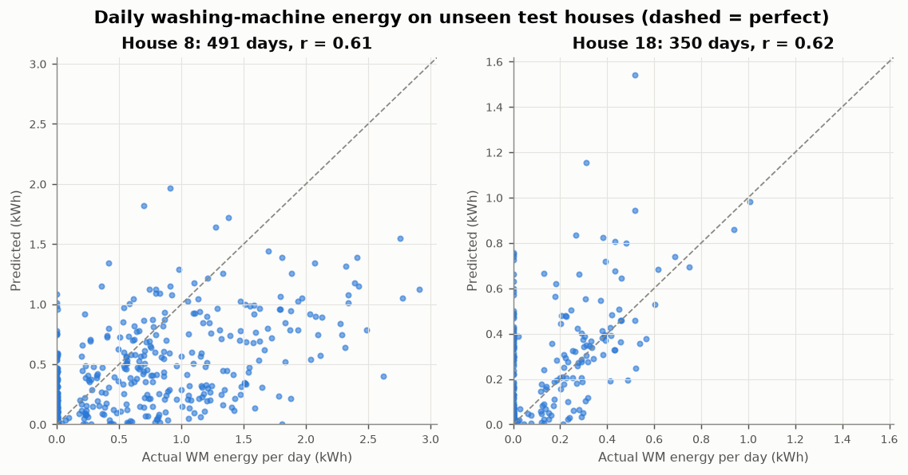

Daily energy is tracked with r ≈ 0.6 in both houses; House 8 sits mostly below the
diagonal (under-estimation of large hot washes), House 18 has a column of points at
"actual = 0" (phantom washes on days without washing).

### 6.7 Residuals and failure cases

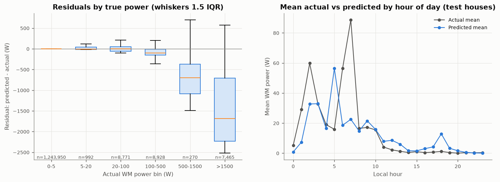

* Residuals are near zero when the machine is off or tumbling (< 100 W), and **strongly
  negative in the > 1.5 kW bin (median ≈ −1.7 kW)**: the model frequently misses or truncates
  the heating phase. By hour, it under-predicts House 8's early-morning washes (02:00 and
  07:00 peaks) — its training houses wash in the day, and the hour features carry that habit.

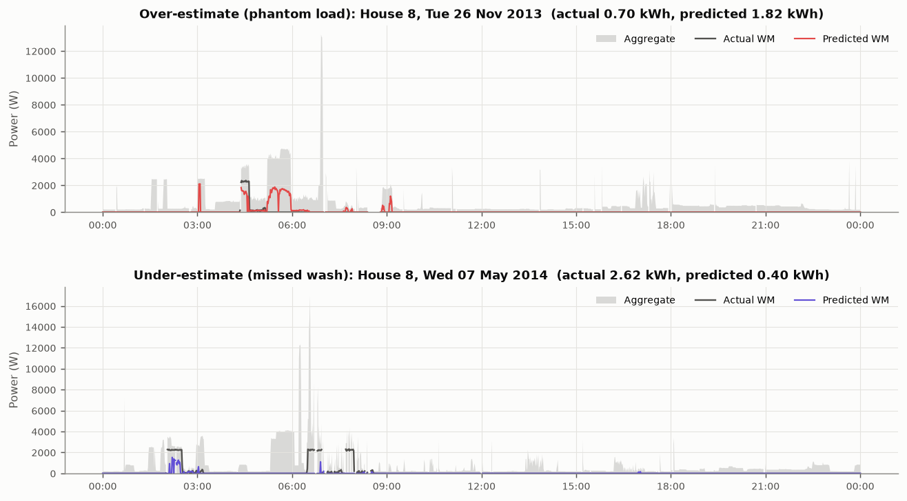

1. **Over-estimate — overlapping heating signatures** (House 8, 26 Nov 2013, predicted
   1.82 vs actual 0.70 kWh). A ~4 kW block around 05:00–06:00 and a 2 kW event at 03:00
   are labelled as washing. House 8 also owns a **washer-dryer on a different channel** whose
   heating looks the same in the aggregate, and kettles/dishwashers produce 2–3 kW steps of
   similar length. Without sub-second features (e.g. reactive power, harmonics) these are
   not separable from 1-minute active power alone.
2. **Under-estimate — unusual timing and back-to-back cycles** (House 8, 7 May 2014,
   predicted 0.40 vs actual 2.62 kWh). Three hot washes run between 02:00 and 08:00 while
   other large loads (a 4 kW block, a 12–16 kW shower-like spike) overlap them. The model
   detects the first heating block partly and misses the others: the night-time timing is
   unlike the training houses, and concurrent loads mask the steps.
3. **Likely to struggle more generally**: cold/quick washes with no heating phase (the
   only strong signature is missing), washer-dryers and tumble dryers (similar heating),
   households with electric showers or immersion heaters, data gaps around a cycle, and
   any machine whose heater power differs from the ~2 kW seen in training.

### 6.8 Feature importance

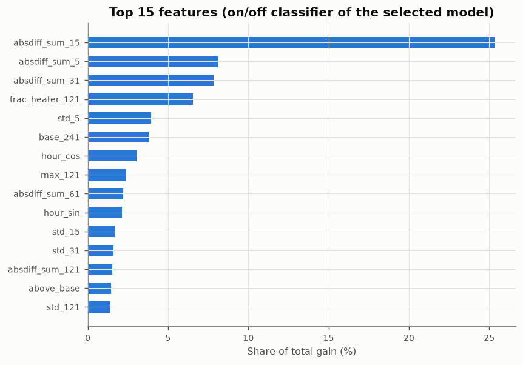

The on/off classifier relies mostly on short-window activity (sum of absolute changes over
5–31 min, short-window std), the share of heater-like minutes in a 2-hour window, the base
load and the hour of day. The prominence of hour features is a double-edged sword: it
helps for "typical" daytime washers and hurts for House 8.

### 6.9 The same model on 15- and 30-minute data (`task3_resolution.csv`)

To answer the Section 4 question with a measurement rather than only an argument, the
1-minute cleaned data were averaged into 15- and 30-minute intervals, which is what a smart
meter's interval energy reading contains. The hurdle model was retrained on the coarse series:
same houses and splits, the same feature durations converted to interval counts, early
stopping and threshold tuned on House 17 (0.30 at 15 min, 0.25 at 30 min). Each interval's
predicted power is spread evenly over its minutes and scored against the **same 1-minute
ground truth and eligible minutes** as the 1-minute model (`src/wattwise/resolution.py`).

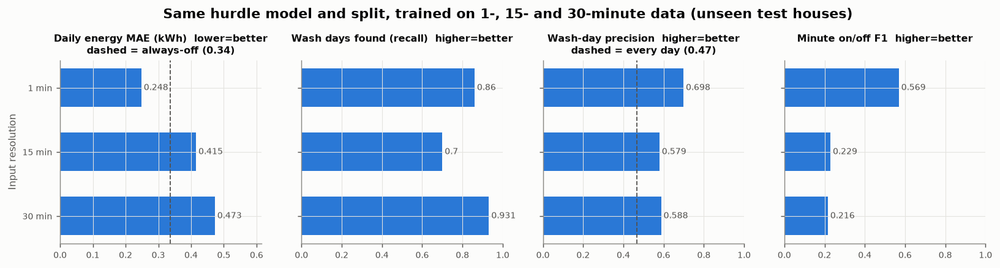

| Test houses 8 + 18 (pooled) | 1 min | 15 min | 30 min | Naive reference |
|---|---|---|---|---|
| Daily energy MAE (kWh) | **0.248** | 0.415 | 0.473 | always-off 0.336 |
| Energy error, House 8 / House 18 | −35 % / +92 % | −40 % / +278 % | +76 % / +239 % | |
| Wash days found (recall) | 0.86 | 0.70 | 0.93 | every day: 1.00 |
| Wash-day precision | **0.70** | 0.58 | 0.59 | every day: 0.47 |
| Minute on/off F1 | **0.57** | 0.23 | 0.22 | |
| Cycle recall / precision | **0.75 / 0.58** | 0.44 / 0.25 | 0.60 / 0.29 | |

A wash day is a day with ≥ 0.1 kWh of washing-machine energy (393 of 841 complete test
days). This measure doesn't depend on resolution. The minute and cycle scores are partly
penalised by averaging, because the cycle rule needs a 300 W peak and averaging lowers peaks.

* **Energy estimates stop being useful.** At both coarse resolutions the daily energy error is
  worse than predicting zero. The 15-minute pooled energy error (−4 %) looks good only because a
  −40 % error in House 8 and a +278 % error in House 18 cancel out.
* **"Did they wash today?" mostly survives, but weakly.** At 30 minutes the model finds 93 % of
  wash days by flagging most days. Its precision (0.59) is only 12 points above simply calling
  every day a wash day (0.47). At 1 minute the precision is 0.70.
* **Why**: in the example below, the 2.5 kW heating block becomes one or two raised intervals that
  look like the cooking and kettle blocks later that morning, and the low-power tumble/spin
  phases vanish into the baseline.

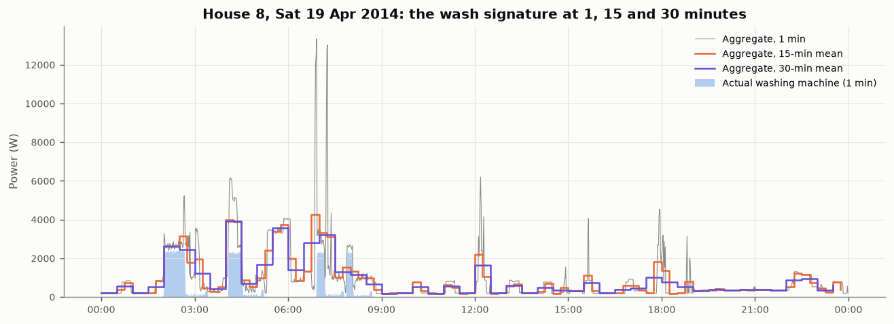

Caveats: the coarse models reuse the 1-minute model's hyperparameters and feature design, so a
model built for interval data might do somewhat better. Real 30-minute meter data would also
add issues that averaged REFIT data do not have, such as missing reads and clock drift. The
direction of the result is still clear: under this split, 15/30-minute data supports
population-level or "probably washed" signals, not per-customer energy estimates.

## 7. What I would do next (and why)

1. **Per-household calibration** — the seen-house experiment shows the biggest gain;
   a few labelled cycles per customer (e.g. from an app "I just started a wash" button) could
   be used to fine-tune or to adjust the hurdle threshold.
2. **Drop or regularise hour-of-day features** and test on more houses (3, 10, 13 from the
   screen) with leave-one-house-out cross-validation to get a confidence interval instead of
   two test houses.
3. **A sequence model (seq2point CNN)** on 2–4-hour windows to learn the whole cycle template
   (heat → tumble → spin) rather than hand-made window statistics; compare under the same
   split and metrics.
4. **Event-level post-processing**: enforce the cycle template (a heating block followed by
   ≥ 30 min of low activity) to suppress kettle/dishwasher false positives.
